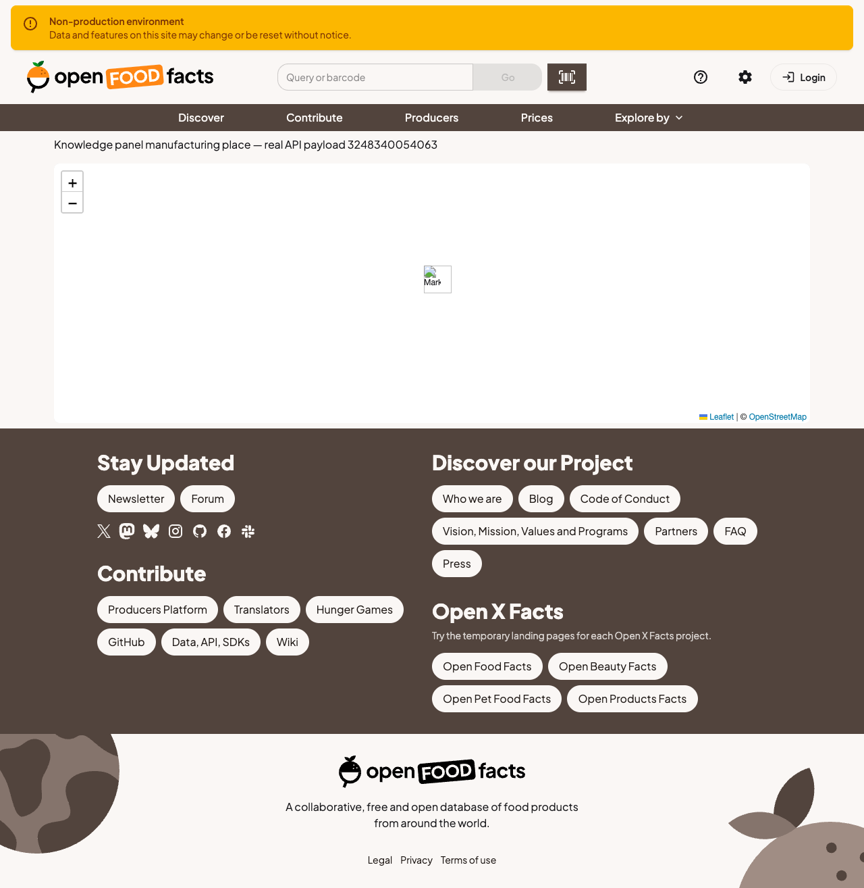

# Explorer knowledge-panel map production asset investigation

Automated investigation on upstream main `4b6f600`; Codex (GPT-6) assisted agentically with research, the local prototype and checks. This is evidence for a maintainer discussion, **not an upstream PR or proof of acceptance**.

Actual caller: `Element.svelte` renders `Map.svelte`. The temporary research page passes the manufacturing-place map coordinates returned by the public API for product `3248340054063` through that renderer. It does not simulate Leaflet or copy its marker implementation.

## Production baseline and bounded prototype

- Vite development: marker and shadow load.
- Unchanged production build: `/marker-icon.png` and `/marker-shadow.png` return 404; both images have naturalWidth 0.
- Map-only prototype: use the explicit Vite icon asset imports and icon geometry already used by the accepted PricesMap fix #1818. Both desktop images load (25/41 pixels). DPR2/mobile uses the retina icon (50 pixels) and shadow (41). The temporary research route is excluded from the candidate diff.

## Reproduce

Use the project's existing frozen lockfile and documented environment setup. Copy research-page.svelte temporarily to src/routes/__research-map/+page.svelte. Run pnpm dev for the development control, then pnpm build and start the adapter-node build on a local port. Run the supplied Playwright probe with MAP_BASE pointing at that port, a JSON/screenshot output prefix, and optional MAP_WIDTH=390 MAP_DPR=2. The probe uses Chrome; adapt its installed channel to your environment. Compare unchanged source with Map-candidate.diff applied. Remove the research route before final contribution validation.

OpenStreetMap tiles are deliberately replaced by a blank image to isolate marker assets; that is why the screenshots have no geographic background. These checks do not reproduce the original Sentry product-server CORS URL exactly, and do not establish live deployment or cross-browser behavior.

Repository validation: format/lint pass, Svelte check reports zero errors/warnings, 23 suites/131 tests pass, production build passes. Existing chunk-size and service-worker source-map warnings remain; no warning-free build is claimed. Final source is Map.svelte only.

The repository PR template requires discussion and maintainer implementation approval, which is not established yet. No personal human understanding, QA or maintainer agreement is certified here.
